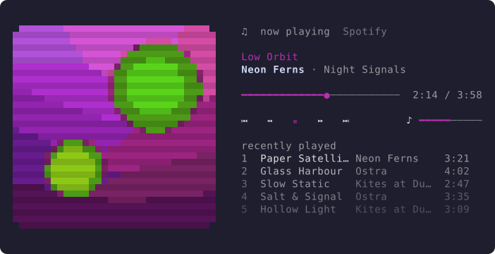
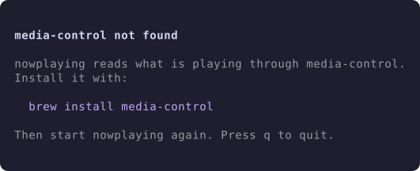
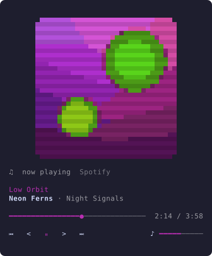
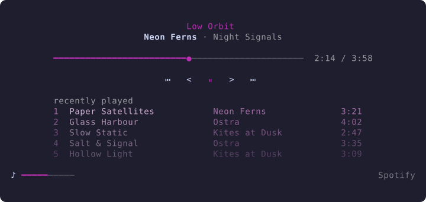

# nowplaying-tui

**nowplaying** is a pixel-art "now playing" card for your terminal. It shows whatever macOS is
playing system-wide (the Spotify desktop app, Apple Music, a browser tab, anything
that reports to Control Center) and lets you control it from the keyboard or mouse.



It is a viewer and remote, not a player. It reads macOS Now Playing through
[`media-control`](https://github.com/ungive/media-control), so there are no API
keys, no OAuth and no streaming-service APIs. It is built to live in a pane
(for example inside tuios) at roughly
80×20 cells and to scale up from there.

**Not included:** playing audio, browsing a library, an "up next" queue (the list
under the card is what you *recently played*, recorded by nowplaying itself).

## Install

nowplaying needs macOS and `media-control`:

```sh
brew tap ungive/media-control
brew install media-control
```

Build nowplaying with Go 1.26 or newer (older Go versions fetch the right toolchain
automatically):

```sh
git clone <this repository> && cd nowplaying-tui
go build -o nowplaying ./cmd/nowplaying
install -m 755 nowplaying /usr/local/bin/nowplaying   # or anywhere on your PATH
```

Run `nowplaying`. If `media-control` is missing, nowplaying shows the install command
instead of crashing:



`nowplaying --demo` runs with scripted tracks and generated covers. It needs no
external tools, so it works on Linux too.

## Using it

| Key | Action |
| --- | --- |
| `space` | Play / pause |
| `n`, `l` | Next track |
| `p`, `h` | Previous track |
| `←` / `→` | Seek −5 s / +5 s (quick presses chain) |
| `+` / `-` | System volume +5 / −5 |
| `r` | Show or hide the recently played list |
| `c` | Clear the recently played list (press `c` again to confirm) |
| `?` | Show or hide the key help line |
| `q`, `ctrl+c` | Quit |

**Mouse:** click the transport row `⏮ < ⏵ > ⏭` (previous, back 5 s, play/pause, forward 5 s, next),
click the progress bar to seek, and scroll over the volume bar to change the volume. With mouse reporting
on, most terminals need a modifier (usually Shift, Option in iTerm2) to select
text. Mouse support also depends on your terminal or multiplexer passing mouse
events through to the pane.

The card never guesses: a key press runs a `media-control` command, and the card
changes when the player reports the result.

### States

- **Playing / paused:** the bar moves smoothly while playing and freezes when
  paused; the play/pause icon flips and the bar dims.
- **Nothing playing:** a dim placeholder cover, an empty bar, and your history is
  still visible.
- **Live streams:** with no duration there is no bar, only the elapsed time.
- **Reconnecting:** if the `media-control` stream dies it is restarted with a
  1 s, 2 s, 5 s, 10 s backoff and the label shows `reconnecting…`.
- **Notes:** a failed command or save is shown on the first line for a few
  seconds (for example `next failed`, `history not saved`).

### Layout

| Pane | What you get |
| --- | --- |
| 70+ columns, landscape | Cover on the left, info on the right, vertically centred |
| under 70 columns, or portrait | Cover stacked above the info, centred; the history fits underneath when there is room |
| under 40 columns or 12 rows, or `show_cover = false` | Text only, no cover |

A pane is *portrait* when it is taller than wide as you see it. Terminal cells are
about twice as tall as they are wide, so that means rows × 2 > columns: 80×41
stacks, 80×40 does not.

The cover is the largest even number of pixels that fits (two pixels per cell
vertically), capped by `art_max_px` and, beside the text, at about 45% of the
width. When stacked, the cover gets a comfortable size first (up to 24 px), the
history gets whatever is left, and the cover grows into any space still unused.
Side margins grow with the pane so wide terminals keep breathing room. The info
column is at least 36 and at most 64 cells wide. Long titles are cut with `…`,
never wrapped.



With `show_cover = false` you get just the text:



## Configuration

nowplaying reads `$XDG_CONFIG_HOME/nowplaying/config.toml`, or
`~/.config/nowplaying/config.toml`. Every key is optional; these are the defaults:

```toml
show_cover       = true      # false hides the cover: text only
art_max_px       = 32        # cover size cap in pixels (8-128)
quantize_colors  = 12        # flat, stylised palette; 0 = off (0-64)
scanlines        = true      # darken every other pixel row by ~12%
accent           = ""        # "#c9a7ff" to override the colour picked from the cover
icons            = "unicode" # "unicode", "basic" or "nerd"
history_size     = 10        # entries kept and shown at most (1-500)
show_history     = true      # false starts with the list hidden (r toggles it)
history_fade     = true      # false draws every history row at full strength
min_play_seconds = 10        # a track must play this long to enter the history
background       = ""        # "#1e1e2e": your terminal's background (see below)
```

Use another file with `nowplaying --config path/to/config.toml`.

A bad config never stops nowplaying. Invalid values fall back to their default, a
file that cannot be parsed is ignored, and a short warning appears on the first
line for a few seconds.

- **`show_cover`:** `false` shows only the text. The accent colour still follows the
  artwork: nowplaying decodes a small copy of the cover just to pick it, and the pick
  does not depend on the cover's size, so resizing the pane never shifts it.
- **`history_size`:** this is both how many tracks are remembered and the most that
  can be shown (fewer if the pane is short). The default is 10. If you used an earlier
  version with a longer saved list, the next save trims it to this size.
- **`show_history` / `history_fade`:** `show_history = false` starts with the list
  hidden and `r` shows it. Hiding only changes the view: tracks are still recorded.
  `history_fade = false` turns off the gradient that dims older rows.
- **`icons`:** `unicode` uses `⏮ < ⏵/⏸ > ⏭`: back and forward are plain ASCII, the
  rest are single-cell symbols. If the pane border drifts or a glyph looks wrong
  in your terminal, use `basic` (`|◂ ◂◂ ▶/▮▮ ▸▸ ▸|`). `nerd` needs a Nerd Font.
- **`accent`:** picked from the cover by default: a k-means pass scored by
  saturation × size that skips near-black and near-white, then adjusted until it
  has at least 3:1 contrast against your terminal background. Setting `accent`
  uses your colour exactly as written.
- **`background`:** the accent, the dim tones and the history fade are all derived
  from your terminal's real background colour. nowplaying asks the terminal for it;
  `--background "#rrggbb"` or this key sets it directly and skips the question.
  Precedence: flag, then config, then the terminal's answer.

### Files

| File | Location |
| --- | --- |
| Config | `$XDG_CONFIG_HOME/nowplaying/config.toml`, or `~/.config/nowplaying/config.toml` |
| History | `$XDG_STATE_HOME/nowplaying/history.json`, or `~/Library/Application Support/nowplaying/history.json` |

The history is written atomically (temp file + rename). If it ever cannot be
parsed it is moved to `history.json.corrupt` and nowplaying starts with an empty list.

### Upgrading from `nowplay`

The app used to be called `nowplay`. Your old config and history are still picked
up: if `nowplaying/` has no file yet, nowplaying reads the one in the old
`nowplay/` folder (same parent directory), and the first save writes the new
location. The old files are only ever read, never moved, changed or deleted, so you
can remove them whenever you like. Anything that launched `nowplay` (a tuios pane,
a shell alias) needs the new command name.

### What counts as "recently played"

When the track changes, the previous one is added if it played for at least
`min_play_seconds`. Paused time does not count, so rapid skipping does not flood
the list. A track is identified by title and artist only: players change the album
name and duration mid-track, and counting those as new tracks would list one song
twice. The same track is never added twice in a row.

## Troubleshooting

- **Nothing happens for about 5 seconds on start.** Your terminal does not answer
  the background-colour query, and Bubble Tea waits for it. Set
  `background = "#rrggbb"` in the config to avoid nowplaying's own query (Bubble Tea's
  startup query happens first and cannot be skipped).
- **The controls look misaligned, the border drifts, or you see boxes.** A glyph is being
  drawn at a different width than nowplaying measured, or your font lacks it; set
  `icons = "basic"`.
- **Browser videos show up.** nowplaying shows anything that reports to macOS Now
  Playing, not just music players.

## How it works

One Bubble Tea program is fed by a background source goroutine; everything slow
(process I/O, image decoding, `osascript`, saving) runs in `tea.Cmd`s, and
`View()` does no I/O.

```text
cmd/nowplaying        flags, wiring, tea.NewProgram
internal/source    Source interface; media-control stream parser; scripted fake for --demo
internal/art       decode, crop, resize, k-means quantise, scanlines, half-block render, accent
internal/history   what counts as played, the list, atomic JSON store
internal/volume    osascript get/set
internal/config    TOML config with defaults and validation
internal/ui        model, view, keys, mouse, theme
testdata/          recorded media-control output and golden renders
```

- `media-control stream --micros` prints one JSON envelope per change
  (`{"type":"data","diff":bool,"payload":{…}}`). A non-diff line replaces the state;
  a diff line merges keys, and `null` clears one. `testdata/README.md` lists what
  the recordings showed.
- The stream runs in its own process group so quitting, or closing the pane,
  stops the `media-control` wrapper *and* its adapter child.
- Covers are drawn with `▀`, foreground = top pixel and background = bottom pixel,
  using raw 24-bit ANSI. Corner pixels are transparent so the corners are rounded.

## Development

```sh
go test ./...                      # unit, golden and end-to-end model tests
go test -race ./...
go test ./internal/art -update     # rewrite the golden cover renders
nowplaying --demo                     # try the UI without media-control
```

The README screenshots are real frames from the app. To regenerate them:

```sh
D=$(mktemp -d)
NOWPLAYING_SNAPSHOT_DIR=$D go test -run TestWriteSnapshots ./internal/ui
for n in wide stacked text idle missing; do python3 scripts/ansi2svg.py $D/$n.ansi docs/$n.svg; done
```

Dependencies: Bubble Tea, Lip Gloss, `golang.org/x/image` (resizing),
`BurntSushi/toml` (config), and `muesli/termenv` (reading the terminal background;
already pulled in by Lip Gloss).
