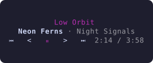

# nowplaying-tui

**nowplaying** is a pixel-art "now playing" card for your terminal. It shows whatever macOS is
playing system-wide (Spotify, Apple Music, a browser tab, anything that reports to
Control Center) and lets you control it from the keyboard or mouse.


It is a viewer and remote, not a player. It reads macOS Now Playing through
[`media-control`](https://github.com/ungive/media-control), so there are no API
keys and no streaming-service APIs. It is built to live in a pane (for example
inside tuios) at roughly 80×20 cells and to scale up from there.

The list under the card is what you *recently played*, recorded by nowplaying
itself. It lives in memory unless you turn on `persist_history`.

## Install

nowplaying needs macOS.

With Homebrew (this also installs `media-control`):

```sh
brew install kraklin/tap/nowplaying
```

Or build it yourself with Go 1.26 or newer, after `brew install media-control`:

```sh
git clone https://github.com/kraklin/nowplaying-tui && cd nowplaying-tui
go build -ldflags "-X main.version=$(git describe --tags --always)" -o nowplaying ./cmd/nowplaying
install -m 755 nowplaying /usr/local/bin/nowplaying   # or anywhere on your PATH
```

Run `nowplaying`. If `media-control` is missing, it shows the install command
instead of crashing:


`nowplaying --demo` runs with scripted tracks and generated covers. It needs no
external tools, so it works on Linux too. `nowplaying --version` prints the version.

## Using it

| Key | Action |
| --- | --- |
| `space` | Play / pause |
| `n`, `l` | Next track |
| `p`, `h` | Previous track |
| `←` / `→` | Seek −5 s / +5 s |
| `+` / `-` | System volume +5 / −5 (also unmutes) |
| `m` | Mute / unmute |
| `a` | Show / hide the cover art |
| `s` | Show / hide the source name (Spotify, Firefox, …) |
| `r` | Show / hide the recently played list |
| `c` | Clear the recently played list (press again to confirm) |
| `?` | Show / hide the key help line |
| `q`, `ctrl+c` | Quit |

**Mouse:** click the transport row `⏮ < ⏵ > ⏭`, click the progress bar to seek,
and scroll over the volume bar to change the volume. Most terminals need a modifier
(usually Shift, Option in iTerm2) to select text while mouse reporting is on, and your
terminal or multiplexer must pass mouse events through to the pane.

The card never guesses: a key press runs a `media-control` command, and the card
changes when the player reports the result.

### Layout

The layout adapts to the pane size:

| Pane | What you get |
| --- | --- |
| 70+ columns, landscape | Cover on the left, info on the right |
| under 70 columns, or portrait | Cover stacked above the info; history underneath if there is room |
| under 40 columns or 12 rows, or `show_cover = false` | Text only, no cover |
| under 30 columns or 10 rows | The compact card |

A pane is *portrait* when rows × 2 > columns, since cells are about twice as tall
as wide (80×41 stacks, 80×40 does not). Long titles are cut with `…`, never wrapped.


The bottom row holds the volume bar (`♪ ━━━━━─────`, or `mute`) on the left and the
source name on the right. Notes (like `next failed`) and the key help share that row,
centred, and push the corners aside when they need the room.

**Compact card:** in a really small pane everything non-essential goes, leaving the
title, the artist and one row with the controls and the time. With fewer rows it
shrinks further, and play/pause is always kept.



### States

- **Nothing playing:** a placeholder cover, an empty bar, and your history stays visible.
- **Live streams:** no duration means no bar, only the elapsed time.
- **Reconnecting:** if the `media-control` stream dies it is restarted with a backoff,
  and `reconnecting…` replaces the source name.
- **Notes:** a failed command or save is shown on the bottom row for a few seconds.

## Configuration

nowplaying reads `$XDG_CONFIG_HOME/nowplaying/config.toml`, or
`~/.config/nowplaying/config.toml`. Every key is optional; these are the defaults:

```toml
show_cover       = true      # false hides the cover: text only (a toggles it)
show_source      = true      # false hides the player name (s toggles it)
art_max_px       = 32        # cover size cap in pixels (8-128)
quantize_colors  = 12        # flat, stylised palette; 0 = off (0-64)
scanlines        = true      # darken every other pixel row by ~12%
accent           = ""        # "#c9a7ff" to override the colour picked from the cover
icons            = "unicode" # "unicode", "basic" or "nerd"
history_size     = 10        # entries kept and shown at most (1-500)
persist_history  = false     # true keeps the list on disk between runs
show_history     = true      # false starts with the list hidden (r toggles it)
history_fade     = true      # false draws every history row at full strength
min_play_seconds = 10        # a track must play this long to enter the history
background       = ""        # "#1e1e2e": your terminal's background (see below)
```

Use another file with `nowplaying --config path/to/config.toml`. A bad config never
stops nowplaying: invalid values fall back to their default, an unparseable file is
ignored, and a short warning appears on the bottom row.

- **Toggles:** `show_cover`, `show_history` and `show_source` only set the starting
  state of the `a`, `r` and `s` keys.
- **`persist_history`:** by default nothing is written to disk. When on, the list is
  saved after every change to `$XDG_STATE_HOME/nowplaying/history.json` (or
  `~/Library/Application Support/nowplaying/history.json`) and loaded at the next
  start. `c` clears the file too. An unparseable file is moved to `history.json.corrupt`.
- **`icons`:** if a glyph looks wrong or the border drifts in your terminal, use
  `basic`. `nerd` needs a Nerd Font.
- **`accent`:** picked from the cover by default (skipping near-black and near-white)
  and adjusted for at least 3:1 contrast against your background. Setting it uses
  your colour exactly as written.
- **`background`:** the accent, dim tones and history fade are derived from your
  terminal's background. nowplaying asks the terminal for it; `--background "#rrggbb"`
  or this key sets it directly. Precedence: flag, config, terminal.

### What counts as "recently played"

When the track changes, the previous one is added if it played for at least
`min_play_seconds` (paused time does not count). A track is identified by title and
artist only, and the same track is never added twice in a row.

## Troubleshooting

- **Nothing happens for about 5 seconds on start.** Your terminal does not answer
  the background-colour query. Set `background = "#rrggbb"` in the config to skip
  nowplaying's own query (Bubble Tea's startup query happens first and cannot be skipped).
- **The controls look misaligned, the border drifts, or you see boxes.** Set
  `icons = "basic"`.
- **Browser videos show up.** nowplaying shows anything that reports to macOS Now
  Playing, not just music players.

## Development

```sh
go test ./...                      # unit, golden and end-to-end model tests
go test -race ./...
go test ./internal/art -update     # rewrite the golden cover renders
nowplaying --demo                  # try the UI without media-control
```

Code layout:

```text
cmd/nowplaying     flags, wiring, tea.NewProgram
internal/source    Source interface; media-control stream parser; scripted fake for --demo
internal/art       decode, crop, resize, quantise, scanlines, half-block render, accent
internal/history   what counts as played, the list, atomic JSON store
internal/volume    osascript get/set
internal/config    TOML config with defaults and validation
internal/ui        model, view, keys, mouse, theme
testdata/          recorded media-control output and golden renders
```

Everything slow (process I/O, image decoding, `osascript`, saving) runs in
`tea.Cmd`s, and `View()` does no I/O. `testdata/README.md` describes the recorded
`media-control` output.

To regenerate the README screenshots:

```sh
D=$(mktemp -d)
NOWPLAYING_SNAPSHOT_DIR=$D go test -run TestWriteSnapshots ./internal/ui
for n in wide stacked text compact idle missing; do python3 scripts/ansi2svg.py $D/$n.ansi docs/$n.svg; done
```

## License

[MIT](LICENSE)
